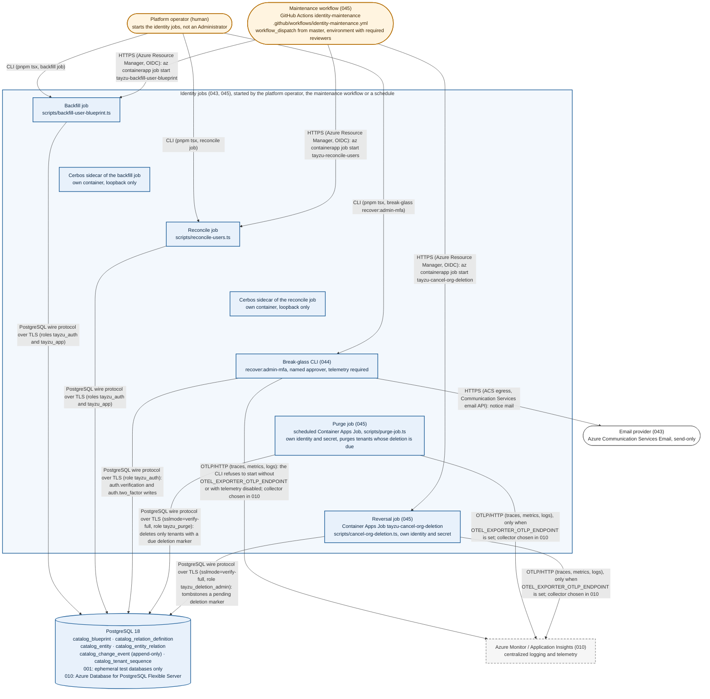

# Tayzu system diagram

This is the single system diagram for the whole Tayzu product, as required by
SSA SEC01. It is maintained as docs-as-code (decision R6 of
`001-catalog-core`): every OpenSpec change that adds a component, an actor or a
network interaction updates it in the same pull request.

**Current state: `003-catalog-ui-core`.** Tayzu is a set of TypeScript
libraries, a PostgreSQL 18 schema and, since 002, the first application:
`apps/api`, a Fastify listener that serves the catalog API and Better Auth's
allowlisted routes, with Cerbos as the only authorization engine. Since 003,
the same container also serves the web app (`apps/web`), a browser SPA, from
`WEB_DIST_DIR`: its assets, its root build files and an `index.html` fallback for
every app page. The SPA calls `/v1` and `/api/auth` on that same origin over
HTTPS, and the browser is redirected to Visma Connect for the sign-in and the
step-up re-authorization (ADR-0025). The
catalog libraries are still also called in-process by tests. Nothing is
deployed yet: the Azure environment is `010`. The process entry point
(`apps/api/src/main.ts`) exists and starts the listener, and the CI DAST job
runs it against a throwaway database. The parts that exist in the repository are drawn solid, and
everything else is planned and drawn dashed, labeled with the change that
introduces it.

## Diagram

```mermaid
---
config:
  flowchart:
    wrappingWidth: 420
---
flowchart TB
    subgraph productActors["Product actors"]
        direction TB
        user(["End user (human)"])
        admin(["Administrator (human)<br/>organization administrator role"])
        agent(["AI agent"])
        integ(["Integration<br/>GitHub, Jira Cloud, Azure DevOps, Aikido,<br/>Orca Security, Escape, CodeRabbit"])
        invitee(["Invitee (human)<br/>with their mailbox"])
        mailClient(["Mail client (044)<br/>the end user's mailbox, receives reset and notice mail"])
        browserSpa(["Browser running the web app SPA (003)<br/>apps/web, loaded from the apps/api origin"])
    end

    subgraph delivery["Development and delivery (outside the product boundary)"]
        dev(["Developer<br/>humans and their Claude Code sessions"])
        ci(["CI: GitHub Actions CI<br/>.github/workflows/ci.yml<br/>lint · typecheck · test (postgres:18 service)<br/>contract:check · otel-smoke-check · pnpm audit · gitleaks<br/>web build · bundle check · gitleaks dir scan of apps/web/dist"])
        dast(["CI: DAST job dast-zap<br/>scripts/ci/dast.sh, throwaway stack per run<br/>ZAP baseline (authenticated, seeded session)<br/>ZAP OpenAPI API scan (safe mode, passive)"])
        e2e(["CI: E2E job e2e<br/>scripts/ci/e2e.sh, throwaway stack per run<br/>Playwright suite of apps/web on Chromium<br/>apps/api serving the web build, TLS proxy, OIDC stub"])
        gh["GitHub repository<br/>nahuex/tayzu"]
        npm["npm registry"]
        operator(["Platform operator (human)<br/>starts the identity jobs, not an Administrator"])
        maintenanceWorkflow(["Maintenance workflow (045)<br/>GitHub Actions identity-maintenance<br/>.github/workflows/identity-maintenance.yml<br/>workflow_dispatch from master, environment with required reviewers"])
    end

    subgraph tayzu["Tayzu (product boundary)"]
        subgraph acaEnv["Azure Container Apps environment (010)"]
            subgraph apiApp["apps/api: Fastify listener (002, code exists; not deployed until 010)"]
                direction TB
                api["Fastify + oRPC API server<br/>onRequest allowlist · CORS · helmet · CSRF · body limit<br/>rate limits · resolveContext · error mapping<br/>Web UI (003)"]
                catalogApi["/v1 catalog API<br/>13 oRPC routes: 12 under /v1/blueprints, GET /v1/search/entities (003)"]
                healthApi["GET /healthz<br/>liveness only, unauthenticated"]
                authApi["Better Auth allowlisted routes<br/>/api/auth/* (deny by default)<br/>including public GET /api/auth/jwks"]
                tokenApi["POST /v1/auth/token<br/>machine credential exchange"]
                ssoApi["Visma Connect sign-in and callback<br/>/api/auth/sign-in/social<br/>/api/auth/callback/visma-connect<br/>/api/auth/link-social · /api/auth/unlink-account"]
                bclApi["Back-channel logout endpoint<br/>POST /v1/auth/visma-connect/backchannel-logout"]
                reauthApi["SSO step-up callback<br/>GET and POST /v1/auth/visma-connect/reauthorize/callback<br/>URL built on BETTER_AUTH_URL"]
                inviteApi["Invitation routes (043)<br/>mounted only when MOUNT_IDENTITY_ROUTES=true (off by default)<br/>POST /v1/users/invitations<br/>POST /v1/users/invitations/{invitation}/cancel<br/>POST /v1/users/invitations/{invitation}/resend"]
                acceptApi["Public accept route (043)<br/>mounted only when MOUNT_IDENTITY_ROUTES=true (off by default)<br/>POST /v1/auth/invitations/accept<br/>unauthenticated, invitation token"]
                userApi["User lifecycle routes (043)<br/>mounted only when MOUNT_IDENTITY_ROUTES=true (off by default)<br/>PUT /v1/users/{user}/status<br/>POST /v1/users<br/>POST /v1/users/{user}/sso-account<br/>DELETE /v1/users/{user}/sso-account"]
                saApi["Service account routes (043)<br/>mounted only when MOUNT_IDENTITY_ROUTES=true (off by default)<br/>POST /v1/service-accounts<br/>DELETE /v1/service-accounts/{user}"]
                credApi["Credential routes (043)<br/>mounted only when MOUNT_IDENTITY_ROUTES=true (off by default)<br/>GET /v1/credentials<br/>POST /v1/credentials<br/>POST /v1/credentials/{credential}/rotate<br/>POST /v1/credentials/{credential}/revoke"]
                resetRequestApi["Public reset request route (044)<br/>mounted only when MOUNT_IDENTITY_ROUTES=true (off by default)<br/>POST /v1/auth/password-reset/request<br/>unauthenticated, uniform response"]
                resetConfirmApi["Public reset confirm route (044)<br/>mounted only when MOUNT_IDENTITY_ROUTES=true (off by default)<br/>POST /v1/auth/password-reset/confirm<br/>unauthenticated, reset token"]
                orgDeleteApi["Organization deletion route (045)<br/>mounted only when MOUNT_IDENTITY_ROUTES=true (off by default)<br/>DELETE /v1/organization<br/>admin with fresh step-up, high-risk"]
                meApi["Session state route (003)<br/>GET /v1/me<br/>session cookie only, uniform 401, per-principal rate limit"]
                webRoutesApi["Web app routes (003)<br/>mounted only when WEB_DIST_DIR is set<br/>GET /assets/* (hashed, immutable) · root build files<br/>SPA fallback: index.html for / and every app page"]
            end
            authn["Better Auth (002)<br/>in-process library"]
            cerbos["Cerbos PDP sidecar (002)<br/>same ACA revision, loopback only<br/>no external arrow<br/>gRPC uses TLS on any other address"]
            mcp["MCP server (013)<br/>MCP endpoint"]
            workers["BullMQ workers (004)<br/>workflow engine, outbox consumer"]
            intg["Integration adapters (008/009)<br/>Integration webhook endpoints<br/>pollers (ACA Jobs), JSONata mapping"]
        end

        system(["System<br/>internal actor: Tayzu's own automation"])

        subgraph core["Catalog core (001): No network attack surface, in-process only"]
            catalog["@tayzu/catalog (library)<br/>domain · persistence · service pipeline<br/>oRPC router + OpenAPI contract (in-process only)"]
            db["@tayzu/db<br/>pg pool · tenant transaction (app.tenant_id)<br/>migration runner · migrations"]
            obs["@tayzu/observability<br/>OTel test harness (in-memory exporters)<br/>SDK bootstrap helper for host apps"]
            pg[("PostgreSQL 18<br/>catalog_blueprint · catalog_relation_definition<br/>catalog_entity · catalog_entity_relation<br/>catalog_change_event (append-only) · catalog_tenant_sequence<br/>001: ephemeral test databases only<br/>010: Azure Database for PostgreSQL Flexible Server")]
        end

        subgraph azure["Azure platform services (010)"]
            redis[("Redis (004)<br/>Azure Cache for Redis (010)")]
            monitor["Azure Monitor / Application Insights (010)<br/>centralized logging and telemetry"]
            acr["Azure Container Registry (010)"]
        end
    end

    subgraph external["Supporting systems (external)"]
        llm["LLM API: Anthropic Claude<br/>via DecisionProvider (004/006/014)"]
        toolApis["Integration tool APIs<br/>GitHub, Jira Cloud, Azure DevOps, Aikido, Escape"]
        visma(["Visma Connect (002)<br/>external OIDC identity provider<br/>connect.visma.com"])
        emailProvider(["Email provider (043)<br/>Azure Communication Services Email, send-only"])
        ghcr(["ghcr.io container registry<br/>Cerbos and ZAP images, pinned by digest"])
        playwrightCdn(["Playwright CDN<br/>Chromium builds for the pinned @playwright/test"])
        pwned(["Pwned Passwords (043)<br/>api.pwnedpasswords.com range API"])
        kv(["Azure Key Vault (002/010)<br/>external secret store<br/>feeds the deployment pipeline and the running container"])
    end

    subgraph identityJobs["Identity jobs (043, 045), started by the platform operator, the maintenance workflow or a schedule"]
        direction TB
        backfillJob["Backfill job<br/>scripts/backfill-user-blueprint.ts"]
        cerbosBackfill["Cerbos sidecar of the backfill job<br/>own container, loopback only"]
        reconcileJob["Reconcile job<br/>scripts/reconcile-users.ts"]
        cerbosReconcile["Cerbos sidecar of the reconcile job<br/>own container, loopback only"]
        breakGlass["Break-glass CLI (044)<br/>recover:admin-mfa, named approver, telemetry required"]
        purgeJob["Purge job (045)<br/>scheduled Container Apps Job, scripts/purge-job.ts<br/>own identity and secret, purges tenants whose deletion is due"]
        reversalJob["Reversal job (045)<br/>Container Apps Job tayzu-cancel-org-deletion<br/>scripts/cancel-org-deletion.ts, own identity and secret"]
    end

    subgraph legend["Legend"]
        direction TB
        lgCurrent["Current component (exists in the repository)"]
        lgPlanned["Planned component (change number)"]
        lgActor(["Actor"])
        lgStore[("Data store")]
        lgExternal["External supporting system"]
        lgCurrent -->|"current interaction: protocol"| lgStore
        lgPlanned -.->|"planned interaction: protocol"| lgExternal
    end

    %% Current interactions (001)
    dev -->|"HTTPS (git push, pull request)"| gh
    dev -->|"in-process call (local Vitest run)"| catalog
    ci -->|"HTTPS (job pickup on push and pull_request,<br/>git checkout)"| gh
    ci -->|"HTTPS (pnpm install, pnpm audit)"| npm
    ci -->|"in-process call (Vitest test run)"| catalog
    ci -->|"in-process call (pnpm db:migrate)"| db
    catalog -->|"in-process call"| db
    catalog -->|"in-process call (OTel API)"| obs
    db -->|"PostgreSQL wire protocol over TLS<br/>(sslmode=verify-full; test harness only:<br/>localhost without TLS)"| pg

    %% Current interactions (002)
    user -->|"HTTPS (browser, session cookie)"| catalogApi
    user -->|"HTTPS (browser, sign-in, session, MFA; anonymous JWKS read)"| authApi
    user -->|"HTTPS (anonymous liveness probe)"| healthApi
    user -->|"HTTPS (browser redirect to sign in and back)"| visma
    agent -->|"HTTPS (Bearer machine access token)"| catalogApi
    agent -->|"HTTPS (client id and secret)"| tokenApi
    ssoApi -->|"outbound HTTPS: discovery, authorize redirect,<br/>token, userinfo, JWKS"| visma
    visma -->|"inbound HTTPS: callback with code and state<br/>(response_mode form_post via the browser)"| ssoApi
    user -->|"HTTPS (browser redirect back from the step-up re-authorization)"| reauthApi
    visma -->|"inbound HTTPS: step-up callback with code and state<br/>(query or form_post via the browser)"| reauthApi
    reauthApi -->|"outbound HTTPS: one token exchange<br/>(5-second timeout)"| visma
    visma -->|"inbound-only HTTPS POST: logout_token<br/>(public, no cookie, unauthenticated by design)"| bclApi
    api -->|"in-process call (resolveContext, auth.handler)"| authn
    api -->|"gRPC (Cerbos PDP API): TLS except when the address is<br/>localhost, 127.0.0.1 or [::1] (sidecar, no TLS)"| cerbos
    authn -->|"in-process call (Drizzle adapter, role tayzu_auth)"| db
    api -->|"in-process call (oRPC OpenAPIHandler)"| catalog
    ci -->|"job pickup (dast-zap)"| dast
    dast -->|"HTTP on localhost (ZAP, seeded session cookie):<br/>the served web app (/, the app pages, /assets/*), /healthz, /v1 and /api/auth/*; safe mode for the API scan"| api
    dast -->|"PostgreSQL over verified TLS (per-run CA, sslmode=verify-full):<br/>owner migrates, apps/api runs as tayzu_app and tayzu_auth"| pg

    %% Current interactions (043)
    admin -->|"HTTPS (browser, session cookie, step-up): invitations"| inviteApi
    admin -->|"HTTPS (browser, session cookie, step-up): user lifecycle"| userApi
    agent -->|"HTTPS (Bearer machine access token): service accounts"| saApi
    admin -->|"HTTPS (browser, session cookie, step-up): credential rotation, revoke, create"| credApi
    agent -->|"HTTPS (Bearer machine access token): credential rotation, revoke, create"| credApi
    inviteApi -->|"HTTPS (ACS egress, Communication Services email API): invitation email"| emailProvider
    emailProvider -->|"SMTP (invitation email delivered to the mailbox)"| invitee
    invitee -->|"HTTPS (browser, public link with the invitation token)"| acceptApi
    authn -->|"HTTPS (Pwned Passwords range query, k-anonymity prefix only):<br/>haveIBeenPwned plugin on the BREACH_CHECKED_PATHS"| pwned
    acceptApi -->|"HTTPS (Pwned Passwords range query, k-anonymity prefix only):<br/>createUser of the new-account path, through Better Auth"| pwned
    %% Current interactions (045)
    admin -->|"HTTPS (browser, session cookie, step-up): organization deletion request"| orgDeleteApi
    orgDeleteApi -->|"HTTPS (ACS egress, Communication Services email API): org-deletion notice to the administrators"| emailProvider
    %% Current interactions (044)
    user -->|"HTTPS/JSON (browser, request a reset link)"| resetRequestApi
    user -->|"HTTPS/JSON (browser, confirm the reset with the token)"| resetConfirmApi
    resetRequestApi -->|"HTTPS (ACS egress, Communication Services email API): reset email"| emailProvider
    resetConfirmApi -->|"HTTPS (ACS egress, Communication Services email API): password and MFA change notices"| emailProvider
    emailProvider -->|"SMTP (reset and notice mail delivered to the mailbox)"| mailClient
    mailClient -->|"IMAP protocol (the user fetches the mail from the mailbox)"| emailProvider
    resetRequestApi -->|"PostgreSQL wire protocol over TLS (role tayzu_auth): auth.verification writes (token digest)"| pg
    resetConfirmApi -->|"PostgreSQL wire protocol over TLS (role tayzu_auth): auth.verification, auth.account, auth.session writes in one transaction"| pg
    resetConfirmApi -->|"HTTPS (Pwned Passwords range query, k-anonymity prefix only)"| pwned
    operator -->|"CLI (pnpm tsx, break-glass recover:admin-mfa)"| breakGlass
    breakGlass -->|"PostgreSQL wire protocol over TLS (role tayzu_auth): auth.verification and auth.two_factor writes"| pg
    breakGlass -->|"HTTPS (ACS egress, Communication Services email API): notice mail"| emailProvider
    breakGlass -->|"OTLP/HTTP (traces, metrics, logs): the CLI refuses to start without<br/>OTEL_EXPORTER_OTLP_ENDPOINT or with telemetry disabled; collector chosen in 010"| monitor
    api -->|"OTLP/HTTP (traces, metrics, logs), only when<br/>OTEL_EXPORTER_OTLP_ENDPOINT is set; collector chosen in 010"| monitor
    ci -->|"HTTPS (docker pull of the Cerbos and ZAP images by digest)"| ghcr
    dev -->|"HTTPS (docker pull of the Cerbos image:<br/>compose, start-cerbos.sh, policy:compile)"| ghcr
    operator -->|"CLI (pnpm tsx, backfill job)"| backfillJob
    operator -->|"CLI (pnpm tsx, reconcile job)"| reconcileJob
    backfillJob -->|"PostgreSQL wire protocol over TLS (roles tayzu_auth and tayzu_app)"| pg
    reconcileJob -->|"PostgreSQL wire protocol over TLS (roles tayzu_auth and tayzu_app)"| pg
    backfillJob -->|"gRPC on a loopback link, no TLS"| cerbosBackfill
    reconcileJob -->|"gRPC on a loopback link, no TLS"| cerbosReconcile
    %% Current interactions (045): the purge, the reversal and the maintenance workflow
    purgeJob -->|"PostgreSQL wire protocol over TLS (sslmode=verify-full, role tayzu_purge): deletes only tenants with a due deletion marker"| pg
    reversalJob -->|"PostgreSQL wire protocol over TLS (sslmode=verify-full, role tayzu_deletion_admin): tombstones a pending deletion marker"| pg
    operator -->|"HTTPS (GitHub, workflow_dispatch): run approved by a required reviewer of the identity-maintenance environment"| maintenanceWorkflow
    maintenanceWorkflow -->|"HTTPS (Azure Resource Manager, OIDC): az containerapp job start tayzu-cancel-org-deletion"| reversalJob
    maintenanceWorkflow -->|"HTTPS (Azure Resource Manager, OIDC): az containerapp job start tayzu-backfill-user-blueprint"| backfillJob
    maintenanceWorkflow -->|"HTTPS (Azure Resource Manager, OIDC): az containerapp job start tayzu-reconcile-users"| reconcileJob
    purgeJob -->|"OTLP/HTTP (traces, metrics, logs), only when<br/>OTEL_EXPORTER_OTLP_ENDPOINT is set; collector chosen in 010"| monitor
    reversalJob -->|"OTLP/HTTP (traces, metrics, logs), only when<br/>OTEL_EXPORTER_OTLP_ENDPOINT is set; collector chosen in 010"| monitor

    %% Current interactions (003): the web app SPA, served by apps/api on the same origin
    browserSpa -->|"HTTPS GET (same origin): /, /assets/* and the app pages"| webRoutesApi
    browserSpa -->|"HTTPS (same origin, session cookie, CSRF header): /v1"| catalogApi
    browserSpa -->|"HTTPS (same origin, session cookie): /api/auth"| authApi
    browserSpa -->|"HTTPS (browser redirect to the Visma Connect sign-in)"| visma
    browserSpa -->|"HTTPS POST (form_post callback from Visma Connect): /api/auth/callback/visma-connect"| ssoApi
    browserSpa -->|"HTTPS (browser redirect to the Visma Connect step-up re-authorization)"| visma
    browserSpa -->|"HTTPS (step-up callback, query or form_post): 303 See Other to /step-up/complete"| reauthApi

    %% Planned interactions
    agent -.->|"MCP Streamable HTTP over HTTPS"| mcp
    integ -.->|"HTTPS (inbound webhooks)"| intg
    intg -.->|"HTTPS (API polling from ACA Jobs)"| toolApis
    mcp -.->|"in-process call (same oRPC procedures,<br/>Better Auth and Cerbos)"| api
    api -.->|"Redis protocol (RESP) over TLS"| redis
    workers -.->|"Redis protocol (RESP) over TLS"| redis
    workers -.->|"in-process call"| catalog
    workers -.->|"HTTPS"| llm
    intg -.->|"in-process call (status writes)"| catalog
    system -.->|"in-process call (actor type system)"| catalog
    obs -.->|"OTLP/HTTPS (OTel SDK exporter in the host apps;<br/>or the Azure Monitor exporter over HTTPS, chosen in 010)"| monitor
    acaEnv -.->|"HTTPS (secret references, managed identity,<br/>resolved into environment variables at container start)"| kv
    ci -.->|"HTTPS (deployment pipeline reads and rotates secret versions)"| kv
    acaEnv -.->|"HTTPS (image pull, managed identity)"| acr
    acaEnv -.->|"HTTPS (image pull of the Cerbos sidecar and the job sidecars)"| ghcr
    ci -.->|"HTTPS (image push)"| acr
    ci -.->|"HTTPS (Azure Resource Manager:<br/>az containerapp update)"| acaEnv
    dev -.->|"HTTPS (Azure portal / CLI, Entra ID)"| azure

    browserSpa -->|"HTTPS GET, same origin, session cookie: /v1/me"| meApi
    ci -->|"job pickup (e2e)"| e2e
    e2e -->|"HTTPS (Chromium download: playwright install --with-deps chromium)"| playwrightCdn
    e2e -->|"HTTPS (docker pull of the Cerbos image by digest)"| ghcr
    e2e -->|"PostgreSQL over verified TLS (per-run CA, sslmode=verify-full):<br/>owner migrates, apps/api and the seed run as tayzu_app and tayzu_auth"| pg

    classDef current fill:#e8f1fb,stroke:#1f5f99,stroke-width:2px,color:#0b2540
    classDef planned fill:#f6f6f6,stroke:#777777,stroke-width:1.5px,stroke-dasharray:6 4,color:#333333
    classDef actor fill:#fff4e0,stroke:#b36b00,stroke-width:2px,color:#3d2400
    classDef externalSys fill:#ffffff,stroke:#555555,stroke-width:1px,color:#222222

    class catalog,db,obs,pg,api,catalogApi,webRoutesApi,healthApi,authApi,tokenApi,ssoApi,bclApi,reauthApi,inviteApi,acceptApi,resetRequestApi,resetConfirmApi,orgDeleteApi,breakGlass,userApi,saApi,credApi,backfillJob,reconcileJob,cerbosBackfill,cerbosReconcile,purgeJob,reversalJob,authn,cerbos,lgCurrent,lgStore,meApi current
    class mcp,workers,intg,redis,monitor,acr,lgPlanned planned
    class user,admin,agent,integ,invitee,mailClient,browserSpa,operator,maintenanceWorkflow,visma,kv,dev,ci,dast,system,lgActor,e2e actor
    class gh,npm,ghcr,llm,toolApis,emailProvider,pwned,lgExternal,playwrightCdn externalSys

    style tayzu fill:#fbfdff,stroke:#1f5f99,stroke-width:3px
    style acaEnv fill:#fafafa,stroke:#777777,stroke-dasharray:6 4
    style azure fill:#fafafa,stroke:#777777,stroke-dasharray:6 4
    style apiApp fill:#f3f8fd,stroke:#1f5f99,stroke-width:2px
    style identityJobs fill:#f3f8fd,stroke:#1f5f99
    style core fill:#f3f8fd,stroke:#1f5f99
    style legend fill:#ffffff,stroke:#bbbbbb
```

## Diagrams per trust zone

The full diagram above is the source of truth. It is also rendered once per
trust zone, so that each PNG stays readable at normal zoom (SSA SEC01, VCDM
O-12, Resolved decision Q147 of `043-identity-lifecycle-and-org-admin`). Each block below draws the nodes of one
zone and only the arrows that cross its boundary, each with its protocol.
Nodes drawn outside the zone box belong to another zone. Arrows between two
nodes of the same zone appear only in the full diagram. Read the colours and
arrow styles in the [Legend](#legend). Each block is rendered to
`docs/architecture/system-diagram-<zone>.png`.

### Product actors

Who reaches Tayzu, and the surfaces they reach, including the two public password-reset routes and the end user's mail client (044), and the browser running the web app SPA (003), which loads the app from the web app routes, calls `/v1` (its own session state from `GET /v1/me` included) and `/api/auth` on the same origin, and follows the Visma Connect sign-in and step-up redirects. PNG: `system-diagram-product-actors.png`.

```mermaid
---
config:
  flowchart:
    wrappingWidth: 420
---
flowchart TB
    subgraph zone["Product actors"]
        direction TB
        user(["End user (human)"])
        admin(["Administrator (human)<br/>organization administrator role"])
        agent(["AI agent"])
        integ(["Integration<br/>GitHub, Jira Cloud, Azure DevOps, Aikido,<br/>Orca Security, Escape, CodeRabbit"])
        invitee(["Invitee (human)<br/>with their mailbox"])
        mailClient(["Mail client (044)<br/>the end user's mailbox, receives reset and notice mail"])
        browserSpa(["Browser running the web app SPA (003)<br/>apps/web, loaded from the apps/api origin"])
        user ~~~ admin
        admin ~~~ agent
        agent ~~~ integ
        integ ~~~ invitee
        invitee ~~~ mailClient
        mailClient ~~~ browserSpa
    end

    catalogApi["/v1 catalog API<br/>13 oRPC routes: 12 under /v1/blueprints, GET /v1/search/entities (003)"]
    authApi["Better Auth allowlisted routes<br/>/api/auth/* (deny by default)<br/>including public GET /api/auth/jwks"]
    healthApi["GET /healthz<br/>liveness only, unauthenticated"]
    visma(["Visma Connect (002)<br/>external OIDC identity provider<br/>connect.visma.com"])
    tokenApi["POST /v1/auth/token<br/>machine credential exchange"]
    reauthApi["SSO step-up callback<br/>GET and POST /v1/auth/visma-connect/reauthorize/callback<br/>URL built on BETTER_AUTH_URL"]
    inviteApi["Invitation routes (043)<br/>mounted only when MOUNT_IDENTITY_ROUTES=true (off by default)<br/>POST /v1/users/invitations<br/>POST /v1/users/invitations/{invitation}/cancel<br/>POST /v1/users/invitations/{invitation}/resend"]
    userApi["User lifecycle routes (043)<br/>mounted only when MOUNT_IDENTITY_ROUTES=true (off by default)<br/>PUT /v1/users/{user}/status<br/>POST /v1/users<br/>POST /v1/users/{user}/sso-account<br/>DELETE /v1/users/{user}/sso-account"]
    saApi["Service account routes (043)<br/>mounted only when MOUNT_IDENTITY_ROUTES=true (off by default)<br/>POST /v1/service-accounts<br/>DELETE /v1/service-accounts/{user}"]
    credApi["Credential routes (043)<br/>mounted only when MOUNT_IDENTITY_ROUTES=true (off by default)<br/>GET /v1/credentials<br/>POST /v1/credentials<br/>POST /v1/credentials/{credential}/rotate<br/>POST /v1/credentials/{credential}/revoke"]
    emailProvider(["Email provider (043)<br/>Azure Communication Services Email, send-only"])
    acceptApi["Public accept route (043)<br/>mounted only when MOUNT_IDENTITY_ROUTES=true (off by default)<br/>POST /v1/auth/invitations/accept<br/>unauthenticated, invitation token"]
    mcp["MCP server (013)<br/>MCP endpoint"]
    intg["Integration adapters (008/009)<br/>Integration webhook endpoints<br/>pollers (ACA Jobs), JSONata mapping"]
    resetRequestApi["Public reset request route (044)<br/>mounted only when MOUNT_IDENTITY_ROUTES=true (off by default)<br/>POST /v1/auth/password-reset/request<br/>unauthenticated, uniform response"]
    resetConfirmApi["Public reset confirm route (044)<br/>mounted only when MOUNT_IDENTITY_ROUTES=true (off by default)<br/>POST /v1/auth/password-reset/confirm<br/>unauthenticated, reset token"]
    orgDeleteApi["Organization deletion route (045)<br/>mounted only when MOUNT_IDENTITY_ROUTES=true (off by default)<br/>DELETE /v1/organization<br/>admin with fresh step-up, high-risk"]
    webRoutesApi["Web app routes (003)<br/>mounted only when WEB_DIST_DIR is set<br/>GET /assets/* (hashed, immutable) · root build files<br/>SPA fallback: index.html for / and every app page"]
    ssoApi["Visma Connect sign-in and callback<br/>/api/auth/sign-in/social<br/>/api/auth/callback/visma-connect<br/>/api/auth/link-social · /api/auth/unlink-account"]

    user -->|"HTTPS (browser, session cookie)"| catalogApi
    user -->|"HTTPS (browser, sign-in, session, MFA; anonymous JWKS read)"| authApi
    user -->|"HTTPS (anonymous liveness probe)"| healthApi
    user -->|"HTTPS (browser redirect to sign in and back)"| visma
    agent -->|"HTTPS (Bearer machine access token)"| catalogApi
    agent -->|"HTTPS (client id and secret)"| tokenApi
    user -->|"HTTPS (browser redirect back from the step-up re-authorization)"| reauthApi
    admin -->|"HTTPS (browser, session cookie, step-up): invitations"| inviteApi
    admin -->|"HTTPS (browser, session cookie, step-up): user lifecycle"| userApi
    agent -->|"HTTPS (Bearer machine access token): service accounts"| saApi
    admin -->|"HTTPS (browser, session cookie, step-up): credential rotation, revoke, create"| credApi
    agent -->|"HTTPS (Bearer machine access token): credential rotation, revoke, create"| credApi
    emailProvider -->|"SMTP (invitation email delivered to the mailbox)"| invitee
    invitee -->|"HTTPS (browser, public link with the invitation token)"| acceptApi
    agent -.->|"MCP Streamable HTTP over HTTPS"| mcp
    integ -.->|"HTTPS (inbound webhooks)"| intg
    user -->|"HTTPS/JSON (browser, request a reset link)"| resetRequestApi
    user -->|"HTTPS/JSON (browser, confirm the reset with the token)"| resetConfirmApi
    emailProvider -->|"SMTP (reset and notice mail delivered to the mailbox)"| mailClient
    mailClient -->|"IMAP protocol (the user fetches the mail from the mailbox)"| emailProvider
    admin -->|"HTTPS (browser, session cookie, step-up): organization deletion request"| orgDeleteApi
    browserSpa -->|"HTTPS GET (same origin): /, /assets/* and the app pages"| webRoutesApi
    browserSpa -->|"HTTPS (same origin, session cookie, CSRF header): /v1"| catalogApi
    browserSpa -->|"HTTPS (same origin, session cookie): /api/auth"| authApi
    browserSpa -->|"HTTPS (browser redirect to the Visma Connect sign-in)"| visma
    browserSpa -->|"HTTPS POST (form_post callback from Visma Connect): /api/auth/callback/visma-connect"| ssoApi
    browserSpa -->|"HTTPS (browser redirect to the Visma Connect step-up re-authorization)"| visma
    browserSpa -->|"HTTPS (step-up callback, query or form_post): 303 See Other to /step-up/complete"| reauthApi

    meApi["Session state route (003)<br/>GET /v1/me<br/>session cookie only, uniform 401, per-principal rate limit"]
    browserSpa -->|"HTTPS GET, same origin, session cookie: /v1/me"| meApi

    classDef current fill:#e8f1fb,stroke:#1f5f99,stroke-width:2px,color:#0b2540
    classDef planned fill:#f6f6f6,stroke:#777777,stroke-width:1.5px,stroke-dasharray:6 4,color:#333333
    classDef actor fill:#fff4e0,stroke:#b36b00,stroke-width:2px,color:#3d2400
    classDef externalSys fill:#ffffff,stroke:#555555,stroke-width:1px,color:#222222
    class catalogApi,webRoutesApi,ssoApi,authApi,healthApi,tokenApi,reauthApi,inviteApi,userApi,saApi,credApi,acceptApi,resetRequestApi,resetConfirmApi,orgDeleteApi,meApi current
    class mcp,intg planned
    class user,admin,agent,integ,invitee,visma,mailClient,browserSpa actor
    class emailProvider externalSys
    style zone fill:#f3f8fd,stroke:#1f5f99,stroke-width:2px
```



### Development and delivery (outside the product boundary)

Developers, CI and the platform operator, outside the product boundary. Since 003, CI also runs the e2e job (`e2e`), which downloads Chromium from the Playwright CDN, pulls the Cerbos image and reaches its throwaway PostgreSQL over verified TLS, and the DAST arrow names the served web app. The operator also starts the break-glass CLI (044) and, since 045, dispatches the GitHub Actions maintenance workflow `identity-maintenance` (`workflow_dispatch`, required reviewers), which starts the reversal job and the 043 backfill and reconcile jobs through OIDC on Azure Resource Manager. PNG: `system-diagram-delivery.png`.

```mermaid
---
config:
  flowchart:
    wrappingWidth: 420
---
flowchart TB
    subgraph zone["Development and delivery (outside the product boundary)"]
        direction TB
        e2e(["CI: E2E job e2e<br/>scripts/ci/e2e.sh, throwaway stack per run<br/>Playwright suite of apps/web on Chromium<br/>apps/api serving the web build, TLS proxy, OIDC stub"])
        dev(["Developer<br/>humans and their Claude Code sessions"])
        ci(["CI: GitHub Actions CI<br/>.github/workflows/ci.yml<br/>lint · typecheck · test (postgres:18 service)<br/>contract:check · otel-smoke-check · pnpm audit · gitleaks<br/>web build · bundle check · gitleaks dir scan of apps/web/dist"])
        dast(["CI: DAST job dast-zap<br/>scripts/ci/dast.sh, throwaway stack per run<br/>ZAP baseline (authenticated, seeded session)<br/>ZAP OpenAPI API scan (safe mode, passive)"])
        gh["GitHub repository<br/>nahuex/tayzu"]
        npm["npm registry"]
        operator(["Platform operator (human)<br/>starts the identity jobs, not an Administrator"])
        maintenanceWorkflow(["Maintenance workflow (045)<br/>GitHub Actions identity-maintenance<br/>.github/workflows/identity-maintenance.yml<br/>workflow_dispatch from master, environment with required reviewers"])
        dev ~~~ ci
        ci ~~~ dast
        dast ~~~ gh
        gh ~~~ npm
        npm ~~~ operator
        operator ~~~ maintenanceWorkflow
    end

    catalog["@tayzu/catalog (library)<br/>domain · persistence · service pipeline<br/>oRPC router + OpenAPI contract (in-process only)"]
    db["@tayzu/db<br/>pg pool · tenant transaction (app.tenant_id)<br/>migration runner · migrations"]
    api["Fastify + oRPC API server<br/>onRequest allowlist · CORS · helmet · CSRF · body limit<br/>rate limits · resolveContext · error mapping<br/>Web UI (003)"]
    pg[("PostgreSQL 18<br/>catalog_blueprint · catalog_relation_definition<br/>catalog_entity · catalog_entity_relation<br/>catalog_change_event (append-only) · catalog_tenant_sequence<br/>001: ephemeral test databases only<br/>010: Azure Database for PostgreSQL Flexible Server")]
    ghcr(["ghcr.io container registry<br/>Cerbos and ZAP images, pinned by digest"])
    backfillJob["Backfill job<br/>scripts/backfill-user-blueprint.ts"]
    reconcileJob["Reconcile job<br/>scripts/reconcile-users.ts"]
    kv(["Azure Key Vault (002/010)<br/>external secret store<br/>feeds the deployment pipeline and the running container"])
    acr["Azure Container Registry (010)"]
    acaEnv["Azure Container Apps environment (010)"]
    azure["Azure platform services (010)"]
    breakGlass["Break-glass CLI (044)<br/>recover:admin-mfa, named approver, telemetry required"]
    reversalJob["Reversal job (045)<br/>Container Apps Job tayzu-cancel-org-deletion<br/>scripts/cancel-org-deletion.ts, own identity and secret"]

    dev -->|"in-process call (local Vitest run)"| catalog
    ci -->|"in-process call (Vitest test run)"| catalog
    ci -->|"in-process call (pnpm db:migrate)"| db
    dast -->|"HTTP on localhost (ZAP, seeded session cookie):<br/>the served web app (/, the app pages, /assets/*), /healthz, /v1 and /api/auth/*; safe mode for the API scan"| api
    dast -->|"PostgreSQL over verified TLS (per-run CA, sslmode=verify-full):<br/>owner migrates, apps/api runs as tayzu_app and tayzu_auth"| pg
    ci -->|"HTTPS (docker pull of the Cerbos and ZAP images by digest)"| ghcr
    dev -->|"HTTPS (docker pull of the Cerbos image:<br/>compose, start-cerbos.sh, policy:compile)"| ghcr
    operator -->|"CLI (pnpm tsx, backfill job)"| backfillJob
    operator -->|"CLI (pnpm tsx, reconcile job)"| reconcileJob
    ci -.->|"HTTPS (deployment pipeline reads and rotates secret versions)"| kv
    ci -.->|"HTTPS (image push)"| acr
    ci -.->|"HTTPS (Azure Resource Manager:<br/>az containerapp update)"| acaEnv
    dev -.->|"HTTPS (Azure portal / CLI, Entra ID)"| azure
    operator -->|"CLI (pnpm tsx, break-glass recover:admin-mfa)"| breakGlass
    maintenanceWorkflow -->|"HTTPS (Azure Resource Manager, OIDC): az containerapp job start tayzu-cancel-org-deletion"| reversalJob
    maintenanceWorkflow -->|"HTTPS (Azure Resource Manager, OIDC): az containerapp job start tayzu-backfill-user-blueprint"| backfillJob
    maintenanceWorkflow -->|"HTTPS (Azure Resource Manager, OIDC): az containerapp job start tayzu-reconcile-users"| reconcileJob

    playwrightCdn(["Playwright CDN<br/>Chromium builds for the pinned @playwright/test"])
    e2e -->|"HTTPS (Chromium download: playwright install --with-deps chromium)"| playwrightCdn
    e2e -->|"HTTPS (docker pull of the Cerbos image by digest)"| ghcr
    e2e -->|"PostgreSQL over verified TLS (per-run CA, sslmode=verify-full):<br/>owner migrates, apps/api and the seed run as tayzu_app and tayzu_auth"| pg

    classDef current fill:#e8f1fb,stroke:#1f5f99,stroke-width:2px,color:#0b2540
    classDef planned fill:#f6f6f6,stroke:#777777,stroke-width:1.5px,stroke-dasharray:6 4,color:#333333
    classDef actor fill:#fff4e0,stroke:#b36b00,stroke-width:2px,color:#3d2400
    classDef externalSys fill:#ffffff,stroke:#555555,stroke-width:1px,color:#222222
    class catalog,db,api,pg,backfillJob,reconcileJob,breakGlass,reversalJob current
    class acr planned
    class dev,ci,dast,operator,maintenanceWorkflow,kv,e2e actor
    class gh,npm,ghcr,playwrightCdn externalSys
    style zone fill:#f3f8fd,stroke:#1f5f99,stroke-width:2px
```



### Azure Container Apps environment (010): API and sidecars

`apps/api` with its routes (the two public password-reset routes of 044, the session state route `GET /v1/me` of 003 and the web app routes of 003 included, the web app routes mounted only when `WEB_DIST_DIR` is set), its in-process libraries and its Cerbos sidecar, plus the planned workers, MCP server and integration adapters. Arrows between nodes of this zone are only in the full diagram. PNG: `system-diagram-api-app.png`.

```mermaid
---
config:
  flowchart:
    wrappingWidth: 420
---
flowchart TB
    subgraph zone["Azure Container Apps environment (010): API and sidecars"]
        direction TB
        meApi["Session state route (003)<br/>GET /v1/me<br/>session cookie only, uniform 401, per-principal rate limit"]
        api["Fastify + oRPC API server<br/>onRequest allowlist · CORS · helmet · CSRF · body limit<br/>rate limits · resolveContext · error mapping<br/>Web UI (003)"]
        catalogApi["/v1 catalog API<br/>13 oRPC routes: 12 under /v1/blueprints, GET /v1/search/entities (003)"]
        healthApi["GET /healthz<br/>liveness only, unauthenticated"]
        authApi["Better Auth allowlisted routes<br/>/api/auth/* (deny by default)<br/>including public GET /api/auth/jwks"]
        tokenApi["POST /v1/auth/token<br/>machine credential exchange"]
        ssoApi["Visma Connect sign-in and callback<br/>/api/auth/sign-in/social<br/>/api/auth/callback/visma-connect<br/>/api/auth/link-social · /api/auth/unlink-account"]
        bclApi["Back-channel logout endpoint<br/>POST /v1/auth/visma-connect/backchannel-logout"]
        reauthApi["SSO step-up callback<br/>GET and POST /v1/auth/visma-connect/reauthorize/callback<br/>URL built on BETTER_AUTH_URL"]
        inviteApi["Invitation routes (043)<br/>mounted only when MOUNT_IDENTITY_ROUTES=true (off by default)<br/>POST /v1/users/invitations<br/>POST /v1/users/invitations/{invitation}/cancel<br/>POST /v1/users/invitations/{invitation}/resend"]
        acceptApi["Public accept route (043)<br/>mounted only when MOUNT_IDENTITY_ROUTES=true (off by default)<br/>POST /v1/auth/invitations/accept<br/>unauthenticated, invitation token"]
        userApi["User lifecycle routes (043)<br/>mounted only when MOUNT_IDENTITY_ROUTES=true (off by default)<br/>PUT /v1/users/{user}/status<br/>POST /v1/users<br/>POST /v1/users/{user}/sso-account<br/>DELETE /v1/users/{user}/sso-account"]
        saApi["Service account routes (043)<br/>mounted only when MOUNT_IDENTITY_ROUTES=true (off by default)<br/>POST /v1/service-accounts<br/>DELETE /v1/service-accounts/{user}"]
        credApi["Credential routes (043)<br/>mounted only when MOUNT_IDENTITY_ROUTES=true (off by default)<br/>GET /v1/credentials<br/>POST /v1/credentials<br/>POST /v1/credentials/{credential}/rotate<br/>POST /v1/credentials/{credential}/revoke"]
        resetRequestApi["Public reset request route (044)<br/>mounted only when MOUNT_IDENTITY_ROUTES=true (off by default)<br/>POST /v1/auth/password-reset/request<br/>unauthenticated, uniform response"]
        resetConfirmApi["Public reset confirm route (044)<br/>mounted only when MOUNT_IDENTITY_ROUTES=true (off by default)<br/>POST /v1/auth/password-reset/confirm<br/>unauthenticated, reset token"]
        orgDeleteApi["Organization deletion route (045)<br/>mounted only when MOUNT_IDENTITY_ROUTES=true (off by default)<br/>DELETE /v1/organization<br/>admin with fresh step-up, high-risk"]
        authn["Better Auth (002)<br/>in-process library"]
        cerbos["Cerbos PDP sidecar (002)<br/>same ACA revision, loopback only<br/>no external arrow<br/>gRPC uses TLS on any other address"]
        mcp["MCP server (013)<br/>MCP endpoint"]
        workers["BullMQ workers (004)<br/>workflow engine, outbox consumer"]
        intg["Integration adapters (008/009)<br/>Integration webhook endpoints<br/>pollers (ACA Jobs), JSONata mapping"]
        webRoutesApi["Web app routes (003)<br/>mounted only when WEB_DIST_DIR is set<br/>GET /assets/* (hashed, immutable) · root build files<br/>SPA fallback: index.html for / and every app page"]
        api ~~~ catalogApi
        catalogApi ~~~ healthApi
        healthApi ~~~ authApi
        authApi ~~~ tokenApi
        tokenApi ~~~ ssoApi
        ssoApi ~~~ bclApi
        bclApi ~~~ reauthApi
        reauthApi ~~~ inviteApi
        inviteApi ~~~ acceptApi
        acceptApi ~~~ userApi
        userApi ~~~ saApi
        saApi ~~~ credApi
        credApi ~~~ resetRequestApi
        resetRequestApi ~~~ resetConfirmApi
        resetConfirmApi ~~~ orgDeleteApi
        orgDeleteApi ~~~ authn
        authn ~~~ cerbos
        cerbos ~~~ mcp
        mcp ~~~ workers
        workers ~~~ intg
        intg ~~~ webRoutesApi
    end

    user(["End user (human)"])
    agent(["AI agent"])
    visma(["Visma Connect (002)<br/>external OIDC identity provider<br/>connect.visma.com"])
    db["@tayzu/db<br/>pg pool · tenant transaction (app.tenant_id)<br/>migration runner · migrations"]
    catalog["@tayzu/catalog (library)<br/>domain · persistence · service pipeline<br/>oRPC router + OpenAPI contract (in-process only)"]
    dast(["CI: DAST job dast-zap<br/>scripts/ci/dast.sh, throwaway stack per run<br/>ZAP baseline (authenticated, seeded session)<br/>ZAP OpenAPI API scan (safe mode, passive)"])
    admin(["Administrator (human)<br/>organization administrator role"])
    emailProvider(["Email provider (043)<br/>Azure Communication Services Email, send-only"])
    invitee(["Invitee (human)<br/>with their mailbox"])
    pwned(["Pwned Passwords (043)<br/>api.pwnedpasswords.com range API"])
    monitor["Azure Monitor / Application Insights (010)<br/>centralized logging and telemetry"]
    integ(["Integration<br/>GitHub, Jira Cloud, Azure DevOps, Aikido,<br/>Orca Security, Escape, CodeRabbit"])
    toolApis["Integration tool APIs<br/>GitHub, Jira Cloud, Azure DevOps, Aikido, Escape"]
    redis[("Redis (004)<br/>Azure Cache for Redis (010)")]
    llm["LLM API: Anthropic Claude<br/>via DecisionProvider (004/006/014)"]
    kv(["Azure Key Vault (002/010)<br/>external secret store<br/>feeds the deployment pipeline and the running container"])
    acr["Azure Container Registry (010)"]
    ghcr(["ghcr.io container registry<br/>Cerbos and ZAP images, pinned by digest"])
    ci(["CI: GitHub Actions CI<br/>.github/workflows/ci.yml<br/>lint · typecheck · test (postgres:18 service)<br/>contract:check · otel-smoke-check · pnpm audit · gitleaks<br/>web build · bundle check · gitleaks dir scan of apps/web/dist"])
    pg[("PostgreSQL 18<br/>catalog_blueprint · catalog_relation_definition<br/>catalog_entity · catalog_entity_relation<br/>catalog_change_event (append-only) · catalog_tenant_sequence<br/>001: ephemeral test databases only<br/>010: Azure Database for PostgreSQL Flexible Server")]

    user -->|"HTTPS (browser, session cookie)"| catalogApi
    user -->|"HTTPS (browser, sign-in, session, MFA; anonymous JWKS read)"| authApi
    user -->|"HTTPS (anonymous liveness probe)"| healthApi
    agent -->|"HTTPS (Bearer machine access token)"| catalogApi
    agent -->|"HTTPS (client id and secret)"| tokenApi
    ssoApi -->|"outbound HTTPS: discovery, authorize redirect,<br/>token, userinfo, JWKS"| visma
    visma -->|"inbound HTTPS: callback with code and state<br/>(response_mode form_post via the browser)"| ssoApi
    user -->|"HTTPS (browser redirect back from the step-up re-authorization)"| reauthApi
    visma -->|"inbound HTTPS: step-up callback with code and state<br/>(query or form_post via the browser)"| reauthApi
    reauthApi -->|"outbound HTTPS: one token exchange<br/>(5-second timeout)"| visma
    visma -->|"inbound-only HTTPS POST: logout_token<br/>(public, no cookie, unauthenticated by design)"| bclApi
    authn -->|"in-process call (Drizzle adapter, role tayzu_auth)"| db
    api -->|"in-process call (oRPC OpenAPIHandler)"| catalog
    dast -->|"HTTP on localhost (ZAP, seeded session cookie):<br/>the served web app (/, the app pages, /assets/*), /healthz, /v1 and /api/auth/*; safe mode for the API scan"| api
    admin -->|"HTTPS (browser, session cookie, step-up): invitations"| inviteApi
    admin -->|"HTTPS (browser, session cookie, step-up): user lifecycle"| userApi
    agent -->|"HTTPS (Bearer machine access token): service accounts"| saApi
    admin -->|"HTTPS (browser, session cookie, step-up): credential rotation, revoke, create"| credApi
    agent -->|"HTTPS (Bearer machine access token): credential rotation, revoke, create"| credApi
    inviteApi -->|"HTTPS (ACS egress, Communication Services email API): invitation email"| emailProvider
    invitee -->|"HTTPS (browser, public link with the invitation token)"| acceptApi
    authn -->|"HTTPS (Pwned Passwords range query, k-anonymity prefix only):<br/>haveIBeenPwned plugin on the BREACH_CHECKED_PATHS"| pwned
    acceptApi -->|"HTTPS (Pwned Passwords range query, k-anonymity prefix only):<br/>createUser of the new-account path, through Better Auth"| pwned
    api -->|"OTLP/HTTP (traces, metrics, logs), only when<br/>OTEL_EXPORTER_OTLP_ENDPOINT is set; collector chosen in 010"| monitor
    agent -.->|"MCP Streamable HTTP over HTTPS"| mcp
    integ -.->|"HTTPS (inbound webhooks)"| intg
    intg -.->|"HTTPS (API polling from ACA Jobs)"| toolApis
    api -.->|"Redis protocol (RESP) over TLS"| redis
    workers -.->|"Redis protocol (RESP) over TLS"| redis
    workers -.->|"in-process call"| catalog
    workers -.->|"HTTPS"| llm
    intg -.->|"in-process call (status writes)"| catalog
    zone -.->|"HTTPS (secret references, managed identity,<br/>resolved into environment variables at container start)"| kv
    zone -.->|"HTTPS (image pull, managed identity)"| acr
    zone -.->|"HTTPS (image pull of the Cerbos sidecar and the job sidecars)"| ghcr
    ci -.->|"HTTPS (Azure Resource Manager:<br/>az containerapp update)"| zone
    user -->|"HTTPS/JSON (browser, request a reset link)"| resetRequestApi
    user -->|"HTTPS/JSON (browser, confirm the reset with the token)"| resetConfirmApi
    resetRequestApi -->|"HTTPS (ACS egress, Communication Services email API): reset email"| emailProvider
    resetConfirmApi -->|"HTTPS (ACS egress, Communication Services email API): password and MFA change notices"| emailProvider
    resetRequestApi -->|"PostgreSQL wire protocol over TLS (role tayzu_auth): auth.verification writes (token digest)"| pg
    resetConfirmApi -->|"PostgreSQL wire protocol over TLS (role tayzu_auth): auth.verification, auth.account, auth.session writes in one transaction"| pg
    resetConfirmApi -->|"HTTPS (Pwned Passwords range query, k-anonymity prefix only)"| pwned
    admin -->|"HTTPS (browser, session cookie, step-up): organization deletion request"| orgDeleteApi
    orgDeleteApi -->|"HTTPS (ACS egress, Communication Services email API): org-deletion notice to the administrators"| emailProvider
    browserSpa(["Browser running the web app SPA (003)<br/>apps/web, loaded from the apps/api origin"])
    browserSpa -->|"HTTPS GET (same origin): /, /assets/* and the app pages"| webRoutesApi
    browserSpa -->|"HTTPS (same origin, session cookie, CSRF header): /v1"| catalogApi
    browserSpa -->|"HTTPS (same origin, session cookie): /api/auth"| authApi
    browserSpa -->|"HTTPS POST (form_post callback from Visma Connect): /api/auth/callback/visma-connect"| ssoApi
    browserSpa -->|"HTTPS (step-up callback, query or form_post): 303 See Other to /step-up/complete"| reauthApi

    browserSpa -->|"HTTPS GET, same origin, session cookie: /v1/me"| meApi

    classDef current fill:#e8f1fb,stroke:#1f5f99,stroke-width:2px,color:#0b2540
    classDef planned fill:#f6f6f6,stroke:#777777,stroke-width:1.5px,stroke-dasharray:6 4,color:#333333
    classDef actor fill:#fff4e0,stroke:#b36b00,stroke-width:2px,color:#3d2400
    classDef externalSys fill:#ffffff,stroke:#555555,stroke-width:1px,color:#222222
    class api,catalogApi,webRoutesApi,healthApi,authApi,tokenApi,ssoApi,bclApi,reauthApi,inviteApi,acceptApi,userApi,saApi,credApi,authn,cerbos,db,catalog,resetRequestApi,resetConfirmApi,orgDeleteApi,pg,meApi current
    class mcp,workers,intg,monitor,redis,acr planned
    class user,agent,visma,browserSpa,dast,admin,invitee,integ,kv,ci actor
    class emailProvider,pwned,toolApis,llm,ghcr externalSys
    style zone fill:#f3f8fd,stroke:#1f5f99,stroke-width:2px
```



### Catalog core (001): no network attack surface, in-process only

The catalog libraries and PostgreSQL, in-process only. The password-reset routes and the break-glass CLI (044) write the `auth` schema as `tayzu_auth`. The purge job (045) connects as `tayzu_purge` and the reversal job (045) as `tayzu_deletion_admin`, each with its one database connection. The CI e2e job (003) reaches its throwaway PostgreSQL over verified TLS. PNG: `system-diagram-core.png`.

```mermaid
---
config:
  flowchart:
    wrappingWidth: 420
---
flowchart TB
    subgraph zone["Catalog core (001): no network attack surface, in-process only"]
        direction TB
        system(["System<br/>internal actor: Tayzu's own automation"])
        catalog["@tayzu/catalog (library)<br/>domain · persistence · service pipeline<br/>oRPC router + OpenAPI contract (in-process only)"]
        db["@tayzu/db<br/>pg pool · tenant transaction (app.tenant_id)<br/>migration runner · migrations"]
        obs["@tayzu/observability<br/>OTel test harness (in-memory exporters)<br/>SDK bootstrap helper for host apps"]
        pg[("PostgreSQL 18<br/>catalog_blueprint · catalog_relation_definition<br/>catalog_entity · catalog_entity_relation<br/>catalog_change_event (append-only) · catalog_tenant_sequence<br/>001: ephemeral test databases only<br/>010: Azure Database for PostgreSQL Flexible Server")]
        system ~~~ catalog
        catalog ~~~ db
        db ~~~ obs
        obs ~~~ pg
    end

    dev(["Developer<br/>humans and their Claude Code sessions"])
    ci(["CI: GitHub Actions CI<br/>.github/workflows/ci.yml<br/>lint · typecheck · test (postgres:18 service)<br/>contract:check · otel-smoke-check · pnpm audit · gitleaks<br/>web build · bundle check · gitleaks dir scan of apps/web/dist"])
    authn["Better Auth (002)<br/>in-process library"]
    api["Fastify + oRPC API server<br/>onRequest allowlist · CORS · helmet · CSRF · body limit<br/>rate limits · resolveContext · error mapping<br/>Web UI (003)"]
    dast(["CI: DAST job dast-zap<br/>scripts/ci/dast.sh, throwaway stack per run<br/>ZAP baseline (authenticated, seeded session)<br/>ZAP OpenAPI API scan (safe mode, passive)"])
    backfillJob["Backfill job<br/>scripts/backfill-user-blueprint.ts"]
    reconcileJob["Reconcile job<br/>scripts/reconcile-users.ts"]
    workers["BullMQ workers (004)<br/>workflow engine, outbox consumer"]
    intg["Integration adapters (008/009)<br/>Integration webhook endpoints<br/>pollers (ACA Jobs), JSONata mapping"]
    monitor["Azure Monitor / Application Insights (010)<br/>centralized logging and telemetry"]
    resetRequestApi["Public reset request route (044)<br/>mounted only when MOUNT_IDENTITY_ROUTES=true (off by default)<br/>POST /v1/auth/password-reset/request<br/>unauthenticated, uniform response"]
    resetConfirmApi["Public reset confirm route (044)<br/>mounted only when MOUNT_IDENTITY_ROUTES=true (off by default)<br/>POST /v1/auth/password-reset/confirm<br/>unauthenticated, reset token"]
    breakGlass["Break-glass CLI (044)<br/>recover:admin-mfa, named approver, telemetry required"]
    purgeJob["Purge job (045)<br/>scheduled Container Apps Job, scripts/purge-job.ts<br/>own identity and secret, purges tenants whose deletion is due"]
    reversalJob["Reversal job (045)<br/>Container Apps Job tayzu-cancel-org-deletion<br/>scripts/cancel-org-deletion.ts, own identity and secret"]

    dev -->|"in-process call (local Vitest run)"| catalog
    ci -->|"in-process call (Vitest test run)"| catalog
    ci -->|"in-process call (pnpm db:migrate)"| db
    authn -->|"in-process call (Drizzle adapter, role tayzu_auth)"| db
    api -->|"in-process call (oRPC OpenAPIHandler)"| catalog
    dast -->|"PostgreSQL over verified TLS (per-run CA, sslmode=verify-full):<br/>owner migrates, apps/api runs as tayzu_app and tayzu_auth"| pg
    backfillJob -->|"PostgreSQL wire protocol over TLS (roles tayzu_auth and tayzu_app)"| pg
    reconcileJob -->|"PostgreSQL wire protocol over TLS (roles tayzu_auth and tayzu_app)"| pg
    workers -.->|"in-process call"| catalog
    intg -.->|"in-process call (status writes)"| catalog
    obs -.->|"OTLP/HTTPS (OTel SDK exporter in the host apps;<br/>or the Azure Monitor exporter over HTTPS, chosen in 010)"| monitor
    resetRequestApi -->|"PostgreSQL wire protocol over TLS (role tayzu_auth): auth.verification writes (token digest)"| pg
    resetConfirmApi -->|"PostgreSQL wire protocol over TLS (role tayzu_auth): auth.verification, auth.account, auth.session writes in one transaction"| pg
    breakGlass -->|"PostgreSQL wire protocol over TLS (role tayzu_auth): auth.verification and auth.two_factor writes"| pg
    purgeJob -->|"PostgreSQL wire protocol over TLS (sslmode=verify-full, role tayzu_purge): deletes only tenants with a due deletion marker"| pg
    reversalJob -->|"PostgreSQL wire protocol over TLS (sslmode=verify-full, role tayzu_deletion_admin): tombstones a pending deletion marker"| pg

    e2e(["CI: E2E job e2e<br/>scripts/ci/e2e.sh, throwaway stack per run<br/>Playwright suite of apps/web on Chromium<br/>apps/api serving the web build, TLS proxy, OIDC stub"])
    e2e -->|"PostgreSQL over verified TLS (per-run CA, sslmode=verify-full):<br/>owner migrates, apps/api and the seed run as tayzu_app and tayzu_auth"| pg

    classDef current fill:#e8f1fb,stroke:#1f5f99,stroke-width:2px,color:#0b2540
    classDef planned fill:#f6f6f6,stroke:#777777,stroke-width:1.5px,stroke-dasharray:6 4,color:#333333
    classDef actor fill:#fff4e0,stroke:#b36b00,stroke-width:2px,color:#3d2400
    classDef externalSys fill:#ffffff,stroke:#555555,stroke-width:1px,color:#222222
    class catalog,db,obs,pg,authn,api,backfillJob,reconcileJob,resetRequestApi,resetConfirmApi,breakGlass,purgeJob,reversalJob current
    class workers,intg,monitor planned
    class system,dev,ci,dast,e2e actor
    style zone fill:#f3f8fd,stroke:#1f5f99,stroke-width:2px
```



### Azure platform services (010)

Planned Azure services (010). The break-glass CLI (044) exports its telemetry over OTLP and refuses to start without an endpoint. The purge and reversal jobs (045) export theirs over OTLP when an endpoint is set. PNG: `system-diagram-azure.png`.

```mermaid
---
config:
  flowchart:
    wrappingWidth: 420
---
flowchart TB
    subgraph zone["Azure platform services (010)"]
        direction TB
        redis[("Redis (004)<br/>Azure Cache for Redis (010)")]
        monitor["Azure Monitor / Application Insights (010)<br/>centralized logging and telemetry"]
        acr["Azure Container Registry (010)"]
        redis ~~~ monitor
        monitor ~~~ acr
    end

    api["Fastify + oRPC API server<br/>onRequest allowlist · CORS · helmet · CSRF · body limit<br/>rate limits · resolveContext · error mapping<br/>Web UI (003)"]
    workers["BullMQ workers (004)<br/>workflow engine, outbox consumer"]
    obs["@tayzu/observability<br/>OTel test harness (in-memory exporters)<br/>SDK bootstrap helper for host apps"]
    acaEnv["Azure Container Apps environment (010)"]
    ci(["CI: GitHub Actions CI<br/>.github/workflows/ci.yml<br/>lint · typecheck · test (postgres:18 service)<br/>contract:check · otel-smoke-check · pnpm audit · gitleaks<br/>web build · bundle check · gitleaks dir scan of apps/web/dist"])
    dev(["Developer<br/>humans and their Claude Code sessions"])
    breakGlass["Break-glass CLI (044)<br/>recover:admin-mfa, named approver, telemetry required"]
    purgeJob["Purge job (045)<br/>scheduled Container Apps Job, scripts/purge-job.ts<br/>own identity and secret, purges tenants whose deletion is due"]
    reversalJob["Reversal job (045)<br/>Container Apps Job tayzu-cancel-org-deletion<br/>scripts/cancel-org-deletion.ts, own identity and secret"]

    api -->|"OTLP/HTTP (traces, metrics, logs), only when<br/>OTEL_EXPORTER_OTLP_ENDPOINT is set; collector chosen in 010"| monitor
    api -.->|"Redis protocol (RESP) over TLS"| redis
    workers -.->|"Redis protocol (RESP) over TLS"| redis
    obs -.->|"OTLP/HTTPS (OTel SDK exporter in the host apps;<br/>or the Azure Monitor exporter over HTTPS, chosen in 010)"| monitor
    acaEnv -.->|"HTTPS (image pull, managed identity)"| acr
    ci -.->|"HTTPS (image push)"| acr
    dev -.->|"HTTPS (Azure portal / CLI, Entra ID)"| zone
    breakGlass -->|"OTLP/HTTP (traces, metrics, logs): the CLI refuses to start without<br/>OTEL_EXPORTER_OTLP_ENDPOINT or with telemetry disabled; collector chosen in 010"| monitor
    purgeJob -->|"OTLP/HTTP (traces, metrics, logs), only when<br/>OTEL_EXPORTER_OTLP_ENDPOINT is set; collector chosen in 010"| monitor
    reversalJob -->|"OTLP/HTTP (traces, metrics, logs), only when<br/>OTEL_EXPORTER_OTLP_ENDPOINT is set; collector chosen in 010"| monitor

    classDef current fill:#e8f1fb,stroke:#1f5f99,stroke-width:2px,color:#0b2540
    classDef planned fill:#f6f6f6,stroke:#777777,stroke-width:1.5px,stroke-dasharray:6 4,color:#333333
    classDef actor fill:#fff4e0,stroke:#b36b00,stroke-width:2px,color:#3d2400
    classDef externalSys fill:#ffffff,stroke:#555555,stroke-width:1px,color:#222222
    class api,obs,breakGlass,purgeJob,reversalJob current
    class redis,monitor,acr,workers planned
    class ci,dev actor
    style zone fill:#f3f8fd,stroke:#1f5f99,stroke-width:2px
```



### Supporting systems (external)

Systems outside Tayzu's responsibility. The email provider also carries the reset and notice mail of 044 to the end user's mail client. Since 003, the browser running the web app SPA is redirected to Visma Connect for the sign-in and, as a separate round trip, for the step-up re-authorization. The CI e2e job (003) downloads Chromium from the Playwright CDN. PNG: `system-diagram-external.png`.

```mermaid
---
config:
  flowchart:
    wrappingWidth: 420
---
flowchart TB
    subgraph zone["Supporting systems (external)"]
        direction TB
        playwrightCdn(["Playwright CDN<br/>Chromium builds for the pinned @playwright/test"])
        llm["LLM API: Anthropic Claude<br/>via DecisionProvider (004/006/014)"]
        toolApis["Integration tool APIs<br/>GitHub, Jira Cloud, Azure DevOps, Aikido, Escape"]
        visma(["Visma Connect (002)<br/>external OIDC identity provider<br/>connect.visma.com"])
        emailProvider(["Email provider (043)<br/>Azure Communication Services Email, send-only"])
        ghcr(["ghcr.io container registry<br/>Cerbos and ZAP images, pinned by digest"])
        pwned(["Pwned Passwords (043)<br/>api.pwnedpasswords.com range API"])
        kv(["Azure Key Vault (002/010)<br/>external secret store<br/>feeds the deployment pipeline and the running container"])
        llm ~~~ toolApis
        toolApis ~~~ visma
        visma ~~~ emailProvider
        emailProvider ~~~ ghcr
        ghcr ~~~ pwned
        pwned ~~~ kv
    end

    user(["End user (human)"])
    ssoApi["Visma Connect sign-in and callback<br/>/api/auth/sign-in/social<br/>/api/auth/callback/visma-connect<br/>/api/auth/link-social · /api/auth/unlink-account"]
    reauthApi["SSO step-up callback<br/>GET and POST /v1/auth/visma-connect/reauthorize/callback<br/>URL built on BETTER_AUTH_URL"]
    bclApi["Back-channel logout endpoint<br/>POST /v1/auth/visma-connect/backchannel-logout"]
    inviteApi["Invitation routes (043)<br/>mounted only when MOUNT_IDENTITY_ROUTES=true (off by default)<br/>POST /v1/users/invitations<br/>POST /v1/users/invitations/{invitation}/cancel<br/>POST /v1/users/invitations/{invitation}/resend"]
    invitee(["Invitee (human)<br/>with their mailbox"])
    authn["Better Auth (002)<br/>in-process library"]
    acceptApi["Public accept route (043)<br/>mounted only when MOUNT_IDENTITY_ROUTES=true (off by default)<br/>POST /v1/auth/invitations/accept<br/>unauthenticated, invitation token"]
    ci(["CI: GitHub Actions CI<br/>.github/workflows/ci.yml<br/>lint · typecheck · test (postgres:18 service)<br/>contract:check · otel-smoke-check · pnpm audit · gitleaks<br/>web build · bundle check · gitleaks dir scan of apps/web/dist"])
    dev(["Developer<br/>humans and their Claude Code sessions"])
    intg["Integration adapters (008/009)<br/>Integration webhook endpoints<br/>pollers (ACA Jobs), JSONata mapping"]
    workers["BullMQ workers (004)<br/>workflow engine, outbox consumer"]
    acaEnv["Azure Container Apps environment (010)"]
    resetRequestApi["Public reset request route (044)<br/>mounted only when MOUNT_IDENTITY_ROUTES=true (off by default)<br/>POST /v1/auth/password-reset/request<br/>unauthenticated, uniform response"]
    resetConfirmApi["Public reset confirm route (044)<br/>mounted only when MOUNT_IDENTITY_ROUTES=true (off by default)<br/>POST /v1/auth/password-reset/confirm<br/>unauthenticated, reset token"]
    mailClient(["Mail client (044)<br/>the end user's mailbox, receives reset and notice mail"])
    breakGlass["Break-glass CLI (044)<br/>recover:admin-mfa, named approver, telemetry required"]
    orgDeleteApi["Organization deletion route (045)<br/>mounted only when MOUNT_IDENTITY_ROUTES=true (off by default)<br/>DELETE /v1/organization<br/>admin with fresh step-up, high-risk"]

    user -->|"HTTPS (browser redirect to sign in and back)"| visma
    ssoApi -->|"outbound HTTPS: discovery, authorize redirect,<br/>token, userinfo, JWKS"| visma
    visma -->|"inbound HTTPS: callback with code and state<br/>(response_mode form_post via the browser)"| ssoApi
    visma -->|"inbound HTTPS: step-up callback with code and state<br/>(query or form_post via the browser)"| reauthApi
    reauthApi -->|"outbound HTTPS: one token exchange<br/>(5-second timeout)"| visma
    visma -->|"inbound-only HTTPS POST: logout_token<br/>(public, no cookie, unauthenticated by design)"| bclApi
    inviteApi -->|"HTTPS (ACS egress, Communication Services email API): invitation email"| emailProvider
    emailProvider -->|"SMTP (invitation email delivered to the mailbox)"| invitee
    authn -->|"HTTPS (Pwned Passwords range query, k-anonymity prefix only):<br/>haveIBeenPwned plugin on the BREACH_CHECKED_PATHS"| pwned
    acceptApi -->|"HTTPS (Pwned Passwords range query, k-anonymity prefix only):<br/>createUser of the new-account path, through Better Auth"| pwned
    ci -->|"HTTPS (docker pull of the Cerbos and ZAP images by digest)"| ghcr
    dev -->|"HTTPS (docker pull of the Cerbos image:<br/>compose, start-cerbos.sh, policy:compile)"| ghcr
    intg -.->|"HTTPS (API polling from ACA Jobs)"| toolApis
    workers -.->|"HTTPS"| llm
    acaEnv -.->|"HTTPS (secret references, managed identity,<br/>resolved into environment variables at container start)"| kv
    ci -.->|"HTTPS (deployment pipeline reads and rotates secret versions)"| kv
    acaEnv -.->|"HTTPS (image pull of the Cerbos sidecar and the job sidecars)"| ghcr
    resetRequestApi -->|"HTTPS (ACS egress, Communication Services email API): reset email"| emailProvider
    resetConfirmApi -->|"HTTPS (ACS egress, Communication Services email API): password and MFA change notices"| emailProvider
    emailProvider -->|"SMTP (reset and notice mail delivered to the mailbox)"| mailClient
    mailClient -->|"IMAP protocol (the user fetches the mail from the mailbox)"| emailProvider
    resetConfirmApi -->|"HTTPS (Pwned Passwords range query, k-anonymity prefix only)"| pwned
    breakGlass -->|"HTTPS (ACS egress, Communication Services email API): notice mail"| emailProvider
    orgDeleteApi -->|"HTTPS (ACS egress, Communication Services email API): org-deletion notice to the administrators"| emailProvider
    browserSpa(["Browser running the web app SPA (003)<br/>apps/web, loaded from the apps/api origin"])
    browserSpa -->|"HTTPS (browser redirect to the Visma Connect sign-in)"| visma
    browserSpa -->|"HTTPS (browser redirect to the Visma Connect step-up re-authorization)"| visma

    e2e(["CI: E2E job e2e<br/>scripts/ci/e2e.sh, throwaway stack per run<br/>Playwright suite of apps/web on Chromium<br/>apps/api serving the web build, TLS proxy, OIDC stub"])
    e2e -->|"HTTPS (Chromium download: playwright install --with-deps chromium)"| playwrightCdn
    e2e -->|"HTTPS (docker pull of the Cerbos image by digest)"| ghcr

    classDef current fill:#e8f1fb,stroke:#1f5f99,stroke-width:2px,color:#0b2540
    classDef planned fill:#f6f6f6,stroke:#777777,stroke-width:1.5px,stroke-dasharray:6 4,color:#333333
    classDef actor fill:#fff4e0,stroke:#b36b00,stroke-width:2px,color:#3d2400
    classDef externalSys fill:#ffffff,stroke:#555555,stroke-width:1px,color:#222222
    class ssoApi,reauthApi,bclApi,inviteApi,authn,acceptApi,resetRequestApi,resetConfirmApi,orgDeleteApi,breakGlass current
    class intg,workers planned
    class visma,kv,user,browserSpa,invitee,ci,dev,mailClient,e2e actor
    class llm,toolApis,emailProvider,ghcr,pwned,playwrightCdn externalSys
    style zone fill:#f3f8fd,stroke:#1f5f99,stroke-width:2px
```



### Identity jobs (043, 045), started by the platform operator, the maintenance workflow or a schedule

The backfill and reconcile jobs of 043, each with its own loopback Cerbos sidecar, the break-glass CLI of 044 (`recover:admin-mfa`), which has no sidecar, and the two Container Apps Jobs of 045: the scheduled purge job (`tayzu_purge`) and the reversal job `tayzu-cancel-org-deletion` (`tayzu_deletion_admin`), which only the maintenance workflow starts. The workflow also starts the backfill and reconcile jobs. PNG: `system-diagram-identity-jobs.png`.



## Legend

| Element                    | Meaning                                                                                                                           |
| -------------------------- | --------------------------------------------------------------------------------------------------------------------------------- |
| Box with a solid border    | Current component: it exists in the repository.                                                                                   |
| Box with a dashed border   | Planned component. The number in parentheses is the OpenSpec change that introduces it.                                           |
| Rounded (stadium) node     | Actor: a human or a system that initiates interactions with Tayzu.                                                                |
| Cylinder                   | Data store.                                                                                                                       |
| Thin plain box             | External supporting system, outside Tayzu's responsibility.                                                                       |
| `Tayzu (product boundary)` | Trust boundary. Everything inside is under Tayzu's responsibility. Every arrow that enters it from an actor is an attack surface. |
| Solid arrow                | Interaction whose code exists in the repository.                                                                                  |
| Dashed arrow               | Planned interaction. The protocol shown is the intended default; the introducing change confirms it and updates this diagram.     |
| Arrow direction            | From initiator to target. The response is implied.                                                                                |

## Components

| Component                                                                                              | Status                      | Notes                                                                                                                                                                                                                                                                                                                                                                                                                                                                                                                                                                                                                                                                                                                                                                                                                                                                                                                              |
| ------------------------------------------------------------------------------------------------------ | --------------------------- | ---------------------------------------------------------------------------------------------------------------------------------------------------------------------------------------------------------------------------------------------------------------------------------------------------------------------------------------------------------------------------------------------------------------------------------------------------------------------------------------------------------------------------------------------------------------------------------------------------------------------------------------------------------------------------------------------------------------------------------------------------------------------------------------------------------------------------------------------------------------------------------------------------------------------------------- |
| `@tayzu/catalog (library)`                                                                             | Current (001)               | Domain, persistence, the operation pipeline and the oRPC router. Invoked in-process only.                                                                                                                                                                                                                                                                                                                                                                                                                                                                                                                                                                                                                                                                                                                                                                                                                                          |
| `@tayzu/db`                                                                                            | Current (001)               | Pool (TLS required outside the test harness), `withTenantTransaction`, migrations.                                                                                                                                                                                                                                                                                                                                                                                                                                                                                                                                                                                                                                                                                                                                                                                                                                                 |
| `@tayzu/observability`                                                                                 | Current (001)               | OTel test harness. The catalog depends on the OTel API only; host apps wire the SDK and exporter.                                                                                                                                                                                                                                                                                                                                                                                                                                                                                                                                                                                                                                                                                                                                                                                                                                  |
| `PostgreSQL 18`                                                                                        | Current (001)               | The six catalog tables. `catalog_change_event` is protected by an append-only trigger. In 001 it runs only as ephemeral test databases (CI `postgres:18` service container, local sandbox cluster), both bound to localhost.                                                                                                                                                                                                                                                                                                                                                                                                                                                                                                                                                                                                                                                                                                       |
| `GitHub Actions CI`                                                                                    | Current (001)               | Pipeline-as-Code in `.github/workflows/ci.yml`, with `permissions: contents: read` and actions pinned by SHA. Since 003, the `lint-typecheck` job also builds the web app, runs its bundle check and scans `apps/web/dist` with gitleaks in `dir` mode. It is Tayzu's component, but GitHub-hosted runners execute it outside the product boundary, so it is drawn as the CI actor.                                                                                                                                                                                                                                                                                                                                                                                                                                                                                                                                                |
| `Fastify + oRPC API server` (`apps/api`)                                                               | Current (002)               | The first listener. `createApp` mounts Better Auth behind a deny-by-default route allowlist and the catalog `OpenAPIHandler`, and adds CORS, helmet, CSRF, a body limit, rate limits and the back-channel logout route. `main.ts` is the process entry point; nothing runs it outside tests and the DAST job until 010.                                                                                                                                                                                                                                                                                                                                                                                                                                                                                                                                                                                                            |
| `Web app SPA` (`apps/web`) and `Web app routes`                                                        | Current (003)               | A React SPA built by Vite. `apps/api` serves it on its own origin only when `WEB_DIST_DIR` is set: the hashed files under `/assets/*` (`immutable`), the root build files (`no-cache`) and `index.html` for `/` and every app page (`no-store`, strict CSP with a per-response style nonce). The SPA calls `/v1` and `/api/auth` on the same origin with the session cookie and, on mutations, the CSRF header. It reads its own session state from the `Session state route` (`GET /v1/me`), which takes the session cookie only (never a bearer token), answers every rejection with the uniform `401` and uses the per-principal rate limit. ADR-0025 and ADR-0026.                                                                                                                                                                                                                                                             |
| `Better Auth` (`@tayzu/auth`)                                                                          | Current (002)               | In-process library on its own `auth` schema and pool (role `tayzu_auth`). Local email and password, MFA, sessions, machine credentials and Visma Connect through `genericOAuth`.                                                                                                                                                                                                                                                                                                                                                                                                                                                                                                                                                                                                                                                                                                                                                   |
| `Cerbos PDP` (`policies/`)                                                                             | Current (002)               | The only authorization engine. Sidecar in the same Container Apps revision, reached over gRPC, with TLS unless the address is `localhost`, `127.0.0.1` or `[::1]` (the sidecar case), and with no external arrow. Policies are baked into the deploy artifact.                                                                                                                                                                                                                                                                                                                                                                                                                                                                                                                                                                                                                                                                     |
| `Visma Connect`                                                                                        | Current (002), external     | Tayzu's primary human identity provider. Outside the boundary. Two interaction kinds: the sign-in and callback round trip that `apps/api` initiates, and an inbound-only back-channel logout POST that Visma Connect initiates. Since 003, the web app SPA starts the sign-in and the step-up re-authorization as browser redirects, and the callbacks come back to `/api/auth/callback/visma-connect` (`form_post`) and to the step-up callback, which answers `303 See Other` to `/step-up/complete`.                                                                                                                                                                                                                                                                                                                                                                                                                            |
| `Identity lifecycle surfaces and jobs`                                                                 | Current (043)               | Invitation, accept, user, service-account and credential routes in `apps/api` (mounted only when `MOUNT_IDENTITY_ROUTES=true`, off by default); invitation email through Azure Communication Services over HTTPS; Pwned Passwords range query made by Better Auth (the `haveIBeenPwned` plugin and the `createUser` of the accept path); backfill and reconcile jobs started by the platform operator, each with its own loopback Cerbos sidecar (gRPC, no TLS) and the roles `tayzu_auth` and `tayzu_app`.                                                                                                                                                                                                                                                                                                                                                                                                                        |
| `Password reset and account recovery`                                                                  | Current (044)               | The two public reset routes in `apps/api` (mounted only when `MOUNT_IDENTITY_ROUTES=true`, off by default); reset and notice mail through Azure Communication Services over HTTPS, delivered to the end user's mail client; Pwned Passwords range query from the confirm route; the break-glass CLI `recover:admin-mfa`, started by the platform operator, which connects as `tayzu_auth`, sends a notice mail and refuses to start without an OTLP endpoint (`OTEL_EXPORTER_OTLP_ENDPOINT`) or with telemetry disabled.                                                                                                                                                                                                                                                                                                                                                                                                           |
| `Organization deletion and data retention`                                                             | Current (045)               | The `DELETE /v1/organization` route in `apps/api` (mounted only when `MOUNT_IDENTITY_ROUTES=true`, off by default) and its notice mail; the purge job (`apps/api/scripts/purge-job.ts`), a scheduled Container Apps Job with its own identity and secret, whose one database connection is `tayzu_purge`; the reversal job (`apps/api/scripts/cancel-org-deletion.ts`, Container Apps Job `tayzu-cancel-org-deletion`), whose one database connection is `tayzu_deletion_admin`; and the GitHub Actions maintenance workflow `identity-maintenance` (`.github/workflows/identity-maintenance.yml`), the only way the reversal starts: a `workflow_dispatch` from `master`, approved by a required reviewer of its environment, that starts the named Container Apps Job through OIDC on Azure Resource Manager (it also starts the 043 backfill and reconcile jobs). Both jobs export telemetry over OTLP when an endpoint is set. |
| `GitHub Actions DAST job` (`dast-zap`)                                                                 | Current (002)               | `.github/workflows/ci.yml` and `scripts/ci/dast.sh`. Per run: a throwaway PostgreSQL 18 behind verified TLS (a per-run CA), migrations as the owner, `apps/api` as the runtime roles `tayzu_app` and `tayzu_auth`. Since 003, `apps/api` also serves the web build (`WEB_DIST_DIR`). Then an authenticated ZAP baseline scan with one seeded session, which also spiders the served web app (`/`, the app pages and `/assets/*`), and a ZAP API scan of the catalog OpenAPI document in safe mode (passive). Any alert fails the job.                                                                                                                                                                                                                                                                                                                                                                                              |
| `GitHub Actions E2E job` (`e2e`)                                                                       | Current (003)               | `.github/workflows/ci.yml` and `scripts/ci/e2e.sh`, a throwaway stack per run: the pinned Cerbos image pulled from ghcr.io by digest, Chromium downloaded from the `Playwright CDN` for the pinned `@playwright/test`, PostgreSQL 18 behind verified TLS (a per-run CA, `sslmode=verify-full`), migrations as the owner, `apps/api` serving the web build and the seed as `tayzu_app` and `tayzu_auth`, a test-only TLS proxy and the OIDC stub of `@tayzu/auth` in place of Visma Connect. Then the Playwright suite of `apps/web` on Chromium. Every secret is random per run and never printed.                                                                                                                                                                                                                                                                                                                                 |
| `Azure Key Vault`                                                                                      | Planned (002/010), external | Secret store outside the boundary. It feeds the deployment pipeline and, through Container Apps secret references, the running container. The application reads environment variables only and uses no Key Vault SDK.                                                                                                                                                                                                                                                                                                                                                                                                                                                                                                                                                                                                                                                                                                              |
| `BullMQ workers`, `Redis`                                                                              | Planned (004)               | Workflow engine and change-event outbox consumer. Redis is Azure Cache for Redis from 010.                                                                                                                                                                                                                                                                                                                                                                                                                                                                                                                                                                                                                                                                                                                                                                                                                                         |
| `Integration adapters`                                                                                 | Planned (008/009)           | Webhook receivers and pollers that write `status` through the catalog.                                                                                                                                                                                                                                                                                                                                                                                                                                                                                                                                                                                                                                                                                                                                                                                                                                                             |
| `MCP server`                                                                                           | Planned (013)               | Exposes the same oRPC procedures as MCP tools, through the same authentication and Cerbos path.                                                                                                                                                                                                                                                                                                                                                                                                                                                                                                                                                                                                                                                                                                                                                                                                                                    |
| `Azure Container Apps environment`, `Azure Container Registry`, `Azure Monitor / Application Insights` | Planned (010)               | Hosting, image registry, and the centralized logging system.                                                                                                                                                                                                                                                                                                                                                                                                                                                                                                                                                                                                                                                                                                                                                                                                                                                                       |

## Actors

| Actor             | Catalog actor type | How it reaches Tayzu                                                                                                                                                                                                                                                                                                                                                                                                                                                                                                   |
| ----------------- | ------------------ | ---------------------------------------------------------------------------------------------------------------------------------------------------------------------------------------------------------------------------------------------------------------------------------------------------------------------------------------------------------------------------------------------------------------------------------------------------------------------------------------------------------------------- |
| End user          | `user`             | Current (002): browser to the `/v1 catalog API` and the Better Auth allowlisted routes with a session cookie, signing in locally or through `Visma Connect`. Current (044, routes mounted only with `MOUNT_IDENTITY_ROUTES=true`): the two public password-reset routes, without a session; the reset and notice mail reaches the user's mail client through the email provider. Current (003): the web app SPA in the browser, loaded from the `Web app routes` and calling `/v1` and `/api/auth` on the same origin. |
| AI agent          | `agent`            | Current (002): the `/v1 catalog API` with a machine access token, obtained at `POST /v1/auth/token`. Planned: the `MCP endpoint` (013). Tayzu's own agents (014) run inside the boundary and take the same path.                                                                                                                                                                                                                                                                                                       |
| Integration       | `integration`      | Current (002): the same machine-token path as an agent. Planned: pushes to the `Integration webhook endpoints` (008/009). The adapters' pollers call the `Integration tool APIs` outbound, so polling is not an inbound surface.                                                                                                                                                                                                                                                                                       |
| Visma Connect     | none               | External identity provider. Sign-in callback and userinfo round trip with `apps/api`, the step-up re-authorization callback, plus an unauthenticated inbound back-channel logout POST validated by signature, issuer, audience and replay (002).                                                                                                                                                                                                                                                                       |
| System            | `system`           | Internal only: Tayzu's own automation (reserved `_` blueprints, schedules, the workflow engine). It is never mapped from an external credential (follow-up T3).                                                                                                                                                                                                                                                                                                                                                        |
| Administrator     | `user`             | Current (043, routes mounted only with `MOUNT_IDENTITY_ROUTES=true`, off by default): a human with the organization administrator role, through a browser session with step-up, on the invitation, user lifecycle and credential routes. Distinct from the Platform operator.                                                                                                                                                                                                                                          |
| Platform operator | none               | Current (043): a human outside the product API who starts the backfill and reconcile jobs from a CLI and, since 044, the break-glass CLI `recover:admin-mfa`. Since 045, reverses a pending organization deletion only by dispatching the `identity-maintenance` GitHub Actions workflow (`workflow_dispatch`, approved by a second human as required reviewer), which starts the reversal job; the purge job runs on a schedule, not by hand. Not an Administrator and holds no session on `apps/api`.                |
| Developer         | none               | Pushes code and reviews pull requests on GitHub, and runs the tests in-process locally. Planned: Azure access with Entra ID (010).                                                                                                                                                                                                                                                                                                                                                                                     |
| CI                | none               | Runs tests and migrations against ephemeral databases on the runner, and, since 003, the e2e job (`e2e`) against a throwaway stack, which downloads Chromium from the Playwright CDN. Planned: pushes images and deploys (010).                                                                                                                                                                                                                                                                                        |

## Attack surfaces

Names match the diagram exactly. The per-route SEC02 documentation for
everything 002 ships is in
[`docs/security/attack-surfaces.md`](../security/attack-surfaces.md); planned
surfaces are documented when the change that introduces them lands.

### Current (002)

Every surface below is served by `apps/api`. The per-route detail (actor
category, authentication, authorization) is in
[`docs/security/attack-surfaces.md`](../security/attack-surfaces.md).

| Attack surface                       | Actors                             | Authentication and authorization                                                                                                                                                                                                                                                                                                             |
| ------------------------------------ | ---------------------------------- | -------------------------------------------------------------------------------------------------------------------------------------------------------------------------------------------------------------------------------------------------------------------------------------------------------------------------------------------- |
| `/v1 catalog API`                    | End user, AI agent, Integration    | Session cookie or machine access token through `resolveContext`, then Cerbos deny-by-default and RLS. CORS allowlist, CSRF header on mutating routes, rate limit.                                                                                                                                                                            |
| `GET /healthz`                       | Anyone (unauthenticated)           | None, by design. Liveness only: `200 {"status":"ok"}`, no dependency check, no detail.                                                                                                                                                                                                                                                       |
| `Better Auth allowlisted routes`     | End user (mostly unauthenticated)  | Deny-by-default allowlist, everything else `404`. Better Auth's own checks, plus pre-authentication brute-force limits on sign-in and two-factor verification. `GET /api/auth/jwks` is public by design (public keys only).                                                                                                                  |
| `POST /v1/auth/token`                | AI agent, Integration              | Client id and secret, a per-IP rate limit, `AUTH_INVALID_CREDENTIALS` on any failure.                                                                                                                                                                                                                                                        |
| `Visma Connect sign-in and callback` | End user, Visma Connect            | Authorization code with PKCE, `state` and `nonce`, verified ID token, `sub`-keyed account link. Every failure is one `401 AUTH_SSO_REJECTED`. Link needs step-up with MFA.                                                                                                                                                                   |
| `SSO step-up callback`               | Visma Connect, through the browser | Single-use `state` (10 minutes) bound to the session that started the re-authorization, no cookie. Exchanges the `code` and stores the ID token for the step-up guard. Bare `200` or `400`.                                                                                                                                                  |
| `Back-channel logout endpoint`       | Visma Connect (unauthenticated)    | No caller identity by design. Validated by signature, `typ`, issuer, audience, `iat` and `exp`, `events`, no `nonce` and `jti` replay. Per-IP rate limit, uniform `200`.                                                                                                                                                                     |
| `Web app routes` (003)               | End user (unauthenticated)         | None, by design: static, public by nature, no data. Mounted only when `WEB_DIST_DIR` is set. `/assets/*` is one route per build file (no client path reaches the file system); the SPA fallback answers `index.html` and has its own per-IP rate limit. Strict CSP. Every data request the app then makes goes through `/v1` or `/api/auth`. |
| `Session state route` (003)          | End user (browser session)         | Session cookie only: a bearer token is no session, and every rejection is the `/v1/*` catch-all's uniform `401`. No Cerbos check: it returns the caller's own session state, read from the session, never from the path, query or body. Per-principal rate limit.                                                                            |
| `Public reset request route` (044)   | End user (unauthenticated)         | None, by design. Mounted only when `MOUNT_IDENTITY_ROUTES=true`. CSRF header and `Origin` allowlist, recipient, IP and global caps, one uniform `200` with a minimum response time.                                                                                                                                                          |
| `Public reset confirm route` (044)   | End user (unauthenticated)         | The reset token in the body is the credential, plus the second factor when the user has one. Mounted only when `MOUNT_IDENTITY_ROUTES=true`. CSRF header and `Origin` allowlist, one uniform `404` for every token or account refusal.                                                                                                       |
| `Azure Key Vault` (deploy time)      | CI, deployment pipeline            | Secret references with managed identity, planned with 010. Not reachable by any end user.                                                                                                                                                                                                                                                    |

The `Cerbos PDP` sidecar is deliberately not an attack surface: nothing
outside the trust boundary talks to it, and it shares a network namespace with
`apps/api` and nothing else. The gRPC link uses TLS unless `CERBOS_ADDRESS` is
`localhost`, `127.0.0.1` or `[::1]`.

For catalog operations, `R.attr.tenantId` is the host-resolved `ctx.tenantId`,
so the `same_tenant` derived role and the cross-tenant deny add no second
tenant check there: Postgres RLS and the repository `tenant_id` filters are the
real barriers. Only `identity.*` passes the target's real tenant (ADR-0015).

The rest of the platform is still planned. The pipeline is
guarded as a supply-chain control (SEC07, SEC13): `permissions:
contents: read`, actions pinned by SHA, `pnpm audit` and gitleaks, plus,
since 003, the web build, its bundle check and a gitleaks `dir` scan of
`apps/web/dist`. The DAST job
(`dast-zap`, tasks 15.1 and 24.9, `scripts/ci/dast.sh`) runs `apps/api` as the
runtime roles against a throwaway PostgreSQL reached over verified TLS (a
per-run CA), with the web build served since 003. It runs an authenticated OWASP
ZAP baseline scan with one seeded session, which also covers the served web app
(`/`, the app pages and `/assets/*`), and a ZAP API scan of every catalog OpenAPI operation in safe mode
(passive). Both fail the job on any alert. The e2e job (`e2e`, 003,
`scripts/ci/e2e.sh`) runs the Playwright suite of `apps/web` on Chromium
against a throwaway stack of its own: PostgreSQL 18 over verified TLS,
`apps/api` serving the web build, a test-only TLS proxy and an OIDC stub.

### Planned

| Attack surface                  | Introduced by | Actors        | Authentication and authorization                                                 |
| ------------------------------- | ------------- | ------------- | -------------------------------------------------------------------------------- |
| `Integration webhook endpoints` | 008/009       | Integration   | Specified in 008/009.                                                            |
| `MCP endpoint`                  | 013           | AI agent      | The same Better Auth and Cerbos path as the `/v1 catalog API`, specified in 013. |
| `Azure platform services`       | 010           | Developer, CI | Entra ID and Azure RBAC, specified in 010 (SEC13, SEC14).                        |

## Keeping this diagram current

- Every change that adds or removes a component, an actor or a network
  interaction updates this file in the same pull request. When a planned
  component ships, its node and arrows become solid.
- Check that the diagram still renders. For Markdown input, mermaid-cli writes
  one file per chart, here `/tmp/d-1.svg`:

  ```sh
  npx -y @mermaid-js/mermaid-cli -i docs/architecture/system-diagram.md -o /tmp/d.svg
  ```

- The SSA (SEC01) asks for a png. Render it with `-o docs/architecture/system-diagram.png`
  (the full diagram with `-s 4`, so that it keeps its 3136-pixel width)
  and commit the result. mermaid-cli writes one file per Mermaid block of a
  Markdown input, numbered in document order: `system-diagram-1.png` is the full
  diagram, so rename it to `system-diagram.png`. The next blocks are the trust
  zones, in the order of the "Diagrams per trust zone" section (product-actors,
  delivery, api-app, core, azure, external, identity-jobs): rename
  `system-diagram-2.png` to `system-diagram-product-actors.png`, and so on.
  Render the zones with `--size 2400` so that the text stays readable at normal
  zoom. Every block that is added or removed shifts the numbers, so check each name.
- The full diagram must stay the first Mermaid block of this file:
  `apps/api/src/system-diagram.test.ts` reads the first one.
- In the cloud sandbox, Puppeteer cannot download Chrome. Pass
  `-p puppeteer.json`, with a config file that sets `executablePath` to the
  preinstalled Chromium under `/opt/pw-browsers` and `args` to
  `["--no-sandbox"]`.
